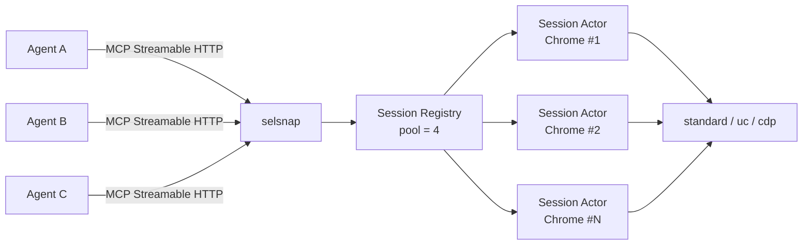

# selsnap

**Semantic, token-efficient Selenium MCP for agent teams**

`sel` + `snap` = Selenium + semantic snapshot


selsnap 把 SeleniumBase 浏览器自动化包装成 MCP 服务。agent 不需要读原始 HTML 或截图，而是拿到一份裁剪后的**语义文本快照**：每个可交互元素带稳定 `ref`，页面带 `doc_id`，导航后自动返回快照。

> 状态：**M0 已可用**（导航 + 快照）。动作管线、会话共享、审计、截图与鉴权在路线图中，暂不适合生产环境。

## 为什么是 selsnap

- **省 token**：快照默认限制 800 个节点 / 16000 字符，只保留标题、地标、链接、表单、按钮等有意义内容。
- **可操作**：元素带稳定引用 `[e12]`，同一文档内跨快照复用；导航后 `doc_id` 变化，提示旧 ref 失效。
- **面向团队**：单进程 Streamable HTTP 服务，命名会话可按名字重连，浏览器池默认上限 4。
- **需要时更隐蔽**：`standard` / `uc` / `cdp` 三种后端；UC 与 CDP 在 Chrome 156 上通过 sannysoft 与 BrowserScan 检测（spike 结论，非 SLA）。
- **Selenium 生态**：基于 SeleniumBase，可以继续复用现有 Selenium 资产与浏览器管理能力。

## 已实现（M0）

- Streamable HTTP MCP 服务（`mcp` 2.3）
- 命名会话 + 每会话 actor 线程串行执行 + 浏览器池上限 4
- 三种浏览器后端：`standard`、`uc`、`cdp`
- `navigate` 自动返回页面快照
- 语义快照：稳定 ref、`doc_id`、节点/字符预算、可见性与 `aria-hidden` 过滤、开放 Shadow DOM 遍历、iframe 占位
- `page_info`：URL、标题、`doc_id`、`readyState`
- URL 策略：仅允许 http/https
- 结构化错误返回（`ok: false` + `error.code/message/hint`）

### 工具

| 工具 | 说明 |
|---|---|
| `session_open(name, mode="standard", headless=None)` | 打开或复用会话；`mode` 为 `standard` / `uc` / `cdp` |
| `session_attach(name)` | 附加到已存在的会话 |
| `session_list()` | 列出当前会话 |
| `session_close(name)` | 关闭会话并释放浏览器 |
| `navigate(session, url)` | 导航到 URL，加载完成后返回快照 |
| `snapshot(session)` | 返回当前页面快照 |
| `page_info(session)` | 返回 URL、标题、`doc_id` 与 `readyState` |

## 快照长什么样

```text
- document "Web Testing Page":
  - form [e1]:
    - table [e2]:
      - row [e3]:
        - cell [e4]:
          - heading "Demo Page" [e5] level=1
        - cell [e6]:
          - heading "SeleniumBase" [e7] level=2
      - row [e11]:
        - cell [e13]:
          - textbox [e14] type="text"
        - cell [e16]:
          - textbox "textareaName" [e17]
      - ...
        - button "Click Me (Green)" [e24]
```

每条元素行的格式是 `- role "name" [ref] attrs`；属性只保留对操作有意义的项，例如 `level`、`value`、`checked`、`disabled`、`href`、`type`。密码框的值恒为掩码 `•••`。

## 快速开始

要求：Python 3.11+，Chrome / Chrome for Testing。

```powershell
git clone https://github.com/3588044667HZ/selsnap.git
cd selsnap
python -m venv .venv
.venv\Scripts\activate
pip install -e .
```

### 浏览器

推荐使用 Chrome for Testing（已验证 **156.0.8078.80**）：

1. 从 [Chrome for Testing](https://googlechromelabs.github.io/chrome-for-testing/) 下载 `chrome-win64.zip`
2. 解压到 `browsers\chrome-win64\chrome.exe`（项目会默认从这里找）
3. 或者启动时用 `--browser "C:\path\to\chrome.exe"` 显式指定

匹配的 chromedriver 由 SeleniumBase 自动管理。

### 启动

```powershell
selsnap --port 8765
```

MCP 端点：`http://127.0.0.1:8765/mcp`

### 连接 MCP 客户端

```json
{
  "mcpServers": {
    "selsnap": {
      "type": "http",
      "url": "http://127.0.0.1:8765/mcp"
    }
  }
}
```

不同客户端对 Streamable HTTP 的 `type` 命名可能是 `http` 或 `streamable-http`，按客户端文档调整。

### 典型调用顺序

1. `session_open(name="researcher", mode="standard")`
2. `navigate(session="researcher", url="https://example.com")` → 返回快照
3. `snapshot(session="researcher")` → 重新观察
4. `session_close(name="researcher")`

## 配置

CLI 参数与环境变量（环境变量前缀 `SELSNAP_`）：

| CLI | 环境变量 | 默认值 | 说明 |
|---|---|---|---|
| `--host` | `SELSNAP_HOST` | `127.0.0.1` | 监听地址 |
| `--port` | `SELSNAP_PORT` | `8765` | 监听端口 |
| `--path` | `SELSNAP_PATH` | `/mcp` | MCP 路径 |
| `--browser` | `SELSNAP_BROWSER` | 自动查找 | Chrome 可执行文件路径 |
| `--headless` / `--no-headless` | `SELSNAP_HEADLESS` | `true` | 无头模式 |
| `--pool-size` | `SELSNAP_POOL_SIZE` | `4` | 并发浏览器上限 |
| `--command-timeout` | `SELSNAP_COMMAND_TIMEOUT` | `90` | 单次会话命令超时（秒） |
| `--page-load-timeout` | `SELSNAP_PAGE_LOAD_TIMEOUT` | `30` | 页面加载超时（秒） |
| `--snapshot-max-nodes` | `SELSNAP_SNAPSHOT_MAX_NODES` | `800` | 快照最大节点数 |
| `--snapshot-max-chars` | `SELSNAP_SNAPSHOT_MAX_CHARS` | `16000` | 快照最大字符数 |
| `--token` | `SELSNAP_TOKEN` | 无 | 预留鉴权（尚未生效） |

## 架构



- MCP 层负责工具路由与请求/响应
- Session Registry 管理命名会话、权限（M2）与池上限
- 每个会话一个 actor 线程，串行执行该浏览器上的命令，避免 WebDriver 竞态
- 浏览器后端统一暴露导航、JS 注入与快照能力

更完整的设计见 [`docs/architecture.md`](docs/architecture.md)。

## 开发与测试

```powershell
pip install -e .
pytest
python scripts/smoke_m0.py
```

当前基线：

- 单元测试 16 个，全部通过
- smoke 端到端 8 项检查（standard + cdp），全部通过
- 三后端快照在 Chrome for Testing 156 上验证

实现说明与 spike 结论见 [`docs/spike-report-2026-10-30.md`](docs/spike-report-2026-10-30.md)。

## 路线图

| 阶段 | 状态 | 内容 |
|---|---|---|
| M0 | ✅ 已完成 | HTTP 服务、会话 actor、`navigate` / `snapshot`、稳定 ref |
| M1 | 下一步 | `click` / `type` / `select` / `press`、动作管线（settle、遮挡检测、重试）、动作后 diff |
| M2 | 计划 | 会话显式 share、ACL、审计、截图与 ref 标注、模式升级 |
| M3 | 计划 | iframe / Shadow DOM 完善、上传下载、secret 注入、CAPTCHA best-effort |

## 已知限制

- 目前只有 M0 工具，**不能点击或输入**（M1）
- 无鉴权、ACL、审计与会话共享（M2）
- 快照暂不支持增量 diff 与全页截图
- 跨源 iframe 只保留占位符，closed shadow root 不可见
- 仅提供 HTTP 传输，暂无 stdio
- 会话不会自动过期，需显式 `session_close` 或随进程退出释放

## 使用边界

- 服务默认只监听 `127.0.0.1`。在鉴权实现前，不要直接暴露到公网。
- `uc` / `cdp` 的绕过能力仅用于你被授权访问的目标；它是提高通过率的手段，不是通用绕过保证。

## 参考项目

- [microsoft/playwright-mcp](https://github.com/microsoft/playwright-mcp) — 语义快照 + ref 的先例
- [seleniumbase/seleniumbase-mcp](https://github.com/seleniumbase/seleniumbase-mcp) — SeleniumBase 官方 MCP
- [ChromeDevTools/chrome-devtools-mcp](https://github.com/ChromeDevTools/chrome-devtools-mcp)
- [angiejones/mcp-selenium](https://github.com/angiejones/mcp-selenium)
- [browser-use/browser-use](https://github.com/browser-use/browser-use) — 元素索引与 DOM 裁剪思路

## License

[MIT](LICENSE) © 2026 3588044667HZ
