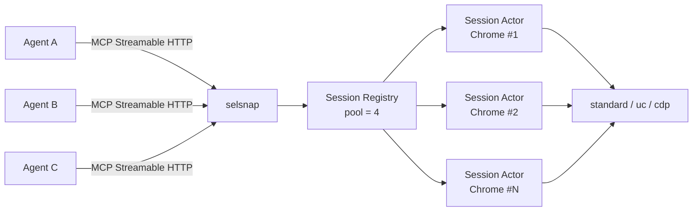

# selsnap

**Semantic, token-efficient Selenium MCP for agent teams**

`sel` + `snap` = Selenium + semantic snapshot


selsnap 把 SeleniumBase 浏览器自动化包装成 MCP 服务。agent 不需要读原始 HTML 或截图，而是拿到一份裁剪后的**语义文本快照**：每个可交互元素带稳定 `ref`，页面带 `doc_id`，导航后自动返回快照。

> 状态：**M2 已可用**（导航 + 快照 + 动作 + 团队共享/审计/鉴权 + 截图）。上传下载、iframe 完善与 CAPTCHA 实测在路线图中，暂不适合生产环境。

## 为什么是 selsnap

- **省 token**：快照默认限制 800 个节点 / 16000 字符，只保留标题、地标、链接、表单、按钮等有意义内容。
- **可操作**：元素带稳定引用 `[e12]`，同一文档内跨快照复用；ref 编号按会话跨文档单调递增，导航后旧 ref 不会误命中新元素。
- **动作自带观测**：`click` / `type` / `select` / `press` / `hover` / `scroll` 会等待页面稳定（settle），默认只返回变更行与新 ref，变化过大或导航时自动返回完整快照。
- **团队可控**：会话默认私有；owner 可 `read` / `write` / `revoke` 共享并设置 TTL；Bearer token 映射到 agent 身份；JSONL 审计记录身份、owner、工具与耗时。
- **视觉辅助**：视口 / 整页 / 元素截图，可叠加 ref 标注气泡，PNG 以 MCP image content 返回。
- **面向团队**：单进程 Streamable HTTP 服务，命名会话可按名字重连，浏览器池默认上限 4。
- **需要时更隐蔽**：`standard` / `uc` / `cdp` 三种后端；挑战页检测 + `session_escalate` 手动/自动升级，profile 保留登录态。
- **Selenium 生态**：基于 SeleniumBase，可以继续复用现有 Selenium 资产与浏览器管理能力。

## 已实现（M2）

- Streamable HTTP MCP 服务（`mcp` 2.3）+ Bearer 鉴权中间件（token → agent，401 覆盖 POST/GET/DELETE）
- 命名会话 + 每会话 actor 线程串行执行 + 浏览器池上限 4
- 会话 ACL：owner、`read` / `write` / `revoke` 共享、TTL、越权返回 `forbidden`
- 审计 JSONL：时间、agent、owner、工具、脱敏参数、耗时、结果、URL、`doc_id`
- 三种浏览器后端：`standard`、`uc`、`cdp`；每会话独立持久 profile
- `navigate` 自动返回页面快照 + 挑战检测；`auto_escalate` 可自动升级模式
- 语义快照：稳定 ref、`doc_id`、节点/字符预算、可见性与 `aria-hidden` 过滤、开放 Shadow DOM 遍历、iframe 占位
- 动作管线：`click` / `type` / `select` / `press` / `hover` / `scroll` / `click_at`
  - ref 失效检测（`stale_ref` 自动附最新快照）
  - 滚动到视口、跨帧稳定、可见/启用/遮挡检查
  - Stale / 遮挡类错误自动重试 2 次
  - settle：MutationObserver 静默 300ms + readyState + 网络静默 500ms，封顶超时
  - 动作后按 ref 对比快照，返回 `added` / `removed` / `updated` 变更行；导航或变化超过 50% 时返回完整快照
- `dialog`：处理原生 alert/confirm/prompt（standard/uc 原生 API，CDP 通过 `Page.handleJavaScriptDialog`）
- `screenshot`：视口 / 整页 / 元素，Pillow 叠加 ref 标注，产物写入 artifact 目录
- `session_escalate`：standard → uc → cdp，同 profile 重启并恢复 URL
- 空闲挂起（默认 2h）：释放浏览器与池许可，下次访问自动恢复；启动时清理孤儿 Chrome/chromedriver
- `page_info`：URL、标题、`doc_id`、`readyState`、挑战检测
- URL 策略：仅允许 http/https
- 结构化错误返回（`ok: false` + `error.code/message/hint`）

### 工具

| 工具 | 说明 |
|---|---|
| `session_open(name, mode="standard", headless=None, auto_escalate=False)` | 打开或复用会话；`mode` 为 `standard` / `uc` / `cdp` |
| `session_attach(name)` | 附加到已存在的会话（挂起会话自动恢复） |
| `session_list()` | 列出当前 agent 可见的会话 |
| `session_close(name)` | 关闭会话并释放浏览器（仅 owner） |
| `session_share(name, agent, mode="read", ttl=None)` | 共享会话：read / write / revoke，可带 TTL |
| `session_escalate(session, mode=None)` | 升级浏览器模式并恢复当前 URL |
| `navigate(session, url)` | 导航到 URL，加载完成后返回快照与挑战检测 |
| `snapshot(session)` | 返回当前页面快照 |
| `page_info(session)` | URL、标题、`doc_id`、`readyState` 与挑战检测 |
| `screenshot(session, ref=None, full_page=False, annotate=False)` | 返回 PNG 图像与元数据 |
| `click(session, ref, button="left", count=1, full=False)` | 点击元素；支持右键与双击 |
| `click_at(session, x, y, button="left", count=1, full=False)` | 按视口坐标点击 |
| `type(session, ref, text, clear=True, submit=False, full=False)` | 输入文本；可清空、可回车提交 |
| `select(session, ref, option, full=False)` | 选择原生下拉框选项 |
| `press(session, keys, ref=None, full=False)` | 发送按键或组合键 |
| `hover(session, ref, full=False)` | 悬停元素 |
| `scroll(session, ref=None, dy=600, full=False)` | 滚动页面或将元素滚动到视口中央 |
| `dialog(session, action="accept", text=None, full=False)` | 处理原生 alert/confirm/prompt |

## 快照长什么样

```text
- document "Web Testing Page":
  - form [e1]:
    - table [e2]:
      - row [e3]:
        - cell [e4]:
          - heading "Demo Page" [e5] level=1
        - cell [e6]:
          - heading "SeleniumBase" [e7] level=2
      - row [e11]:
        - cell [e13]:
          - textbox [e14] type="text"
        - cell [e16]:
          - textbox "textareaName" [e17]
      - ...
        - button "Click Me (Green)" [e24]
```

每条元素行的格式是 `- role "name" [ref] attrs`；属性只保留对操作有意义的项，例如 `level`、`value`、`checked`、`disabled`、`href`、`type`。密码框的值恒为掩码 `•••`。

## 快速开始

要求：Python 3.11+，Chrome / Chrome for Testing。

```powershell
git clone https://github.com/3588044667HZ/selsnap.git
cd selsnap
python -m venv .venv
.venv\Scripts\activate
pip install -e .
```

### 浏览器

推荐使用 Chrome for Testing（已验证 **156.0.8078.80**）：

1. 从 [Chrome for Testing](https://googlechromelabs.github.io/chrome-for-testing/) 下载 `chrome-win64.zip`
2. 解压到 `browsers\chrome-win64\chrome.exe`（项目会默认从这里找）
3. 或者启动时用 `--browser "C:\path\to\chrome.exe"` 显式指定

匹配的 chromedriver 由 SeleniumBase 自动管理。

### 启动

```powershell
selsnap --port 8765
```

MCP 端点：`http://127.0.0.1:8765/mcp`

### 连接 MCP 客户端

不带鉴权（仅本机）：

```json
{
  "mcpServers": {
    "selsnap": {
      "type": "http",
      "url": "http://127.0.0.1:8765/mcp"
    }
  }
}
```

启用 Bearer 鉴权后需要带 header：

```json
{
  "mcpServers": {
    "selsnap": {
      "type": "http",
      "url": "http://127.0.0.1:8765/mcp",
      "headers": { "Authorization": "Bearer YOUR_TOKEN" }
    }
  }
}
```

不同客户端对 Streamable HTTP 的 `type` 命名可能是 `http` 或 `streamable-http`，按客户端文档调整。

### 典型调用顺序

1. `session_open(name="researcher", mode="standard")`
2. `navigate(session="researcher", url="https://example.com")` → 返回快照与挑战检测
3. `click(session="researcher", ref="e12")` → 返回 diff（无变化时 `changed: false`）
4. `type(session="researcher", ref="e14", text="selsnap")` → 返回 diff
5. `screenshot(session="researcher", full_page=True, annotate=True)` → 返回 PNG + 元数据
6. `snapshot(session="researcher")` → 重新观察完整页面
7. `session_close(name="researcher")`

动作工具默认只返回变更行；`full=true` 可强制返回完整快照。`stale_ref` 错误会附带最新快照，直接使用其中的新 ref 重试即可。

## 配置

CLI 参数与环境变量（环境变量前缀 `SELSNAP_`）：

| CLI | 环境变量 | 默认值 | 说明 |
|---|---|---|---|
| `--host` | `SELSNAP_HOST` | `127.0.0.1` | 监听地址 |
| `--port` | `SELSNAP_PORT` | `8765` | 监听端口 |
| `--path` | `SELSNAP_PATH` | `/mcp` | MCP 路径 |
| `--browser` | `SELSNAP_BROWSER` | 自动查找 | Chrome 可执行文件路径 |
| `--headless` / `--no-headless` | `SELSNAP_HEADLESS` | `true` | 无头模式 |
| `--pool-size` | `SELSNAP_POOL_SIZE` | `4` | 并发浏览器上限 |
| `--command-timeout` | `SELSNAP_COMMAND_TIMEOUT` | `90` | 单次会话命令超时（秒） |
| `--page-load-timeout` | `SELSNAP_PAGE_LOAD_TIMEOUT` | `30` | 页面加载超时（秒） |
| `--settle-timeout` | `SELSNAP_SETTLE_TIMEOUT` | `5` | 动作后 settle 封顶超时（秒） |
| `--snapshot-max-nodes` | `SELSNAP_SNAPSHOT_MAX_NODES` | `800` | 快照最大节点数 |
| `--snapshot-max-chars` | `SELSNAP_SNAPSHOT_MAX_CHARS` | `16000` | 快照最大字符数 |
| `--token` | `SELSNAP_TOKEN` | 无 | 单 token，映射到 `--agent-name` |
| `--tokens-json` | `SELSNAP_TOKENS` | 无 | `{token: agent}` JSON 映射，可多 agent |
| `--agent-name` | `SELSNAP_AGENT_NAME` | `local` | 单 token / 无鉴权时的 agent 名 |
| `--audit` / `--no-audit` | `SELSNAP_AUDIT` | `true` | 是否写审计 JSONL |
| `--audit-dir` | `SELSNAP_AUDIT_DIR` | `var/` | 审计目录，文件名 `audit-YYYY-MM-DD.jsonl` |
| `--artifact-dir` | `SELSNAP_ARTIFACT_DIR` | `var/artifacts/` | 截图输出目录 |
| `--profile-root` | `SELSNAP_PROFILE_ROOT` | `var/profiles/` | 每会话 Chrome profile 根目录 |
| `--idle-timeout` | `SELSNAP_IDLE_TIMEOUT` | `7200` | 空闲挂起秒数；0 表示禁用 |
| `--idle-check-interval` | `SELSNAP_IDLE_CHECK_INTERVAL` | `60` | 空闲扫描间隔（秒） |

鉴权示例：

```powershell
$env:SELSNAP_TOKENS='{"token-a":"agent-a","token-b":"agent-b"}'
selsnap --port 8765
```

未配置任何 token 时鉴权关闭，所有请求按 `local`（或 `--agent-name`）身份处理。

## 架构



- MCP 层负责工具路由、Bearer 鉴权与请求/响应
- Session Registry 管理命名会话、ACL/share、空闲挂起与池上限
- 每个会话一个 actor 线程，串行执行该浏览器上的命令，避免 WebDriver 竞态
- 浏览器后端统一暴露导航、JS 注入、快照、截图与对话框能力
- 审计与截图产物写入本地 `var/`（可配置），不上传第三方

更完整的设计见 [`docs/architecture.md`](docs/architecture.md)。

## 开发与测试

```powershell
pip install -e .
pytest
python scripts/smoke_m0.py
python scripts/smoke_m1.py
python scripts/smoke_m2.py
```

当前基线：

- 单元测试 76 个，全部通过（快照/diff、动作、ACL、审计脱敏、身份映射、challenge、截图标注、挂起恢复）
- smoke M0 端到端 8 项检查（standard + cdp），全部通过
- smoke M1 端到端 16 项检查（standard + uc + cdp 的动作、导航后 diff 与 stale_ref），全部通过
- smoke M2 端到端 20 项检查（双 agent share/ACL/TTL、401、审计、截图、click_at、dialog、escalate、auto_escalate、空闲挂起恢复）
- 三后端快照、动作、截图与对话框在 Chrome for Testing 156 上验证

实现说明与 spike 结论见 [`docs/spike-report-2026-10-30.md`](docs/spike-report-2026-10-30.md)。

## 路线图

| 阶段 | 状态 | 内容 |
|---|---|---|
| M0 | ✅ 已完成 | HTTP 服务、会话 actor、`navigate` / `snapshot`、稳定 ref |
| M1 | ✅ 已完成 | `click` / `type` / `select` / `press` / `hover` / `scroll`、settle、遮挡检测、stale 重试、动作后 diff |
| M2 | ✅ 已完成 | share/ACL/TTL、审计 JSONL、Bearer 鉴权、截图与 ref 标注、`click_at`、dialog、模式升级、空闲挂起、孤儿清理 |
| M3 | 下一步 | iframe / Shadow DOM 完善、上传下载、secret 注入、CAPTCHA best-effort、超时重启 |

## 已知限制

- 动作后 diff 按 ref 对比；不支持跨文档 diff（导航时直接返回完整快照）
- 部分站点有多个并发弹窗；`dialog` 一次处理一个，需要连续调用
- 共享写权限不做强锁，多个 agent 同时写同一会话需自行协调
- 审计写入本地 JSONL，不做集中日志与防篡改
- 截图最大 4000 万像素；超长页面会直接报 `screenshot_failed`
- 超时命令不会自动重启会话（M3）
- 跨源 iframe 只保留占位符，closed shadow root 不可见
- 自定义下拉（非原生 `<select>`）需用 `click` 序列操作
- 仅提供 HTTP 传输，暂无 stdio
- 会话默认 2h 空闲挂起（保留 profile），需显式 `session_close` 才会释放 profile

## 使用边界

- 服务默认只监听 `127.0.0.1`。需要跨机器访问时，**务必启用 Bearer 鉴权**并放在反向代理/内网之后。
- 共享写权限意味着被授权 agent 可以操作你的登录态与页面数据，只共享给可信 agent。
- `uc` / `cdp` 的绕过能力仅用于你被授权访问的目标；它是提高通过率的手段，不是通用绕过保证。

## 参考项目

- [microsoft/playwright-mcp](https://github.com/microsoft/playwright-mcp) — 语义快照 + ref 的先例
- [seleniumbase/seleniumbase-mcp](https://github.com/seleniumbase/seleniumbase-mcp) — SeleniumBase 官方 MCP
- [ChromeDevTools/chrome-devtools-mcp](https://github.com/ChromeDevTools/chrome-devtools-mcp)
- [angiejones/mcp-selenium](https://github.com/angiejones/mcp-selenium)
- [browser-use/browser-use](https://github.com/browser-use/browser-use) — 元素索引与 DOM 裁剪思路

## License

[MIT](LICENSE) © 2026 3588044667HZ
